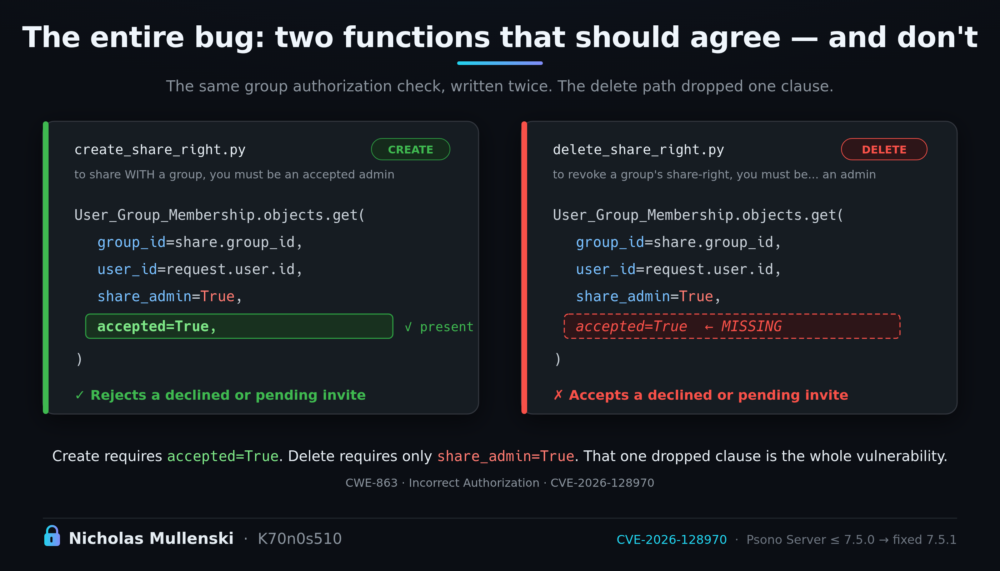
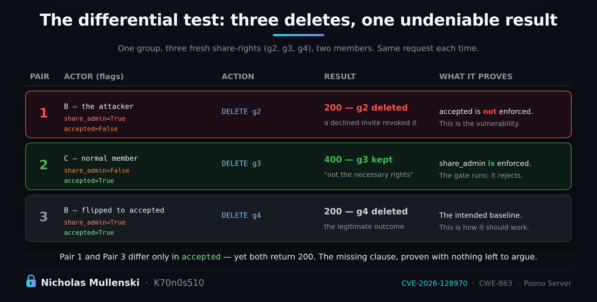

# CVE-2026-128970 — Missing membership-acceptance check lets a group invitee delete a team's share-rights (Psono Server)

**Summary:** Psono Server's `DELETE /share/right/` authorizes group share-right deletion on `share_admin=True`
but omits the `accepted=True` clause that the matching *create* path requires. A user who was merely invited
to a group with share-admin rights — and who never accepted, or explicitly declined, the invitation — can
delete that group's share-right records, revoking access to the shared secrets for every accepted member.

| | |
|---|---|
| **CVE** | [CVE-2026-128970](https://www.cve.org/CVERecord?id=CVE-2026-128970) |
| **GHSA** | [GHSA-6r6m-8qp2-f3cm](https://github.com/advisories/GHSA-6r6m-8qp2-f3cm) (GitHub Advisory Database) |
| **Vendor / Product** | esaqa GmbH — Psono Server (Community Edition & Enterprise Edition) |
| **Affected versions** | Community Edition **1.12.6 – 7.5.0**; Enterprise Edition **< 7.5.1** |
| **Fixed in** | **7.5.1** (both editions, released 2026-10-13) |
| **Vulnerability type** | Incorrect Authorization (CWE-863) |
| **CVSS v3.1** | **5.4 (Medium)** — `AV:N/AC:L/PR:L/UI:N/S:U/C:N/I:L/A:L` |
| **Attack vector** | Authenticated, network; low privilege (an invited group member) |
| **Impact** | Integrity & availability of sharing ACLs; **no** secret-plaintext disclosure (server is E2E-encrypted) |
| **Discovery method** | Source-code audit — comparing the create vs. delete authorization checks |
| **CNA** | esaqa GmbH |
| **Researcher** | Nicholas Mullenski (`K70n0s510`) |

## Description

The declarative sharing model stores group membership in a `User_Group_Membership` row carrying two flags:
`share_admin` (may this member manage the group's shares) and `accepted` (has this person accepted the invite).

The engine's authors correctly require **both** flags on the path that shares *into* a group
(`restapi/serializers/create_share_right.py`):

```python
User_Group_Membership.objects.get(
    group_id=attrs["group_id"],
    user_id=self.context["request"].user.id,
    share_admin=True,
    accepted=True,
)
```

The sibling path that **revokes** a group's share-right (`restapi/serializers/delete_share_right.py`) omits
the `accepted=True` clause:

```python
User_Group_Membership.objects.get(
    group_id=share_right.group_id,
    user_id=self.context["request"].user.id,
    share_admin=True,
)
```

Because declining an invitation does not delete the membership row — it sets `accepted = False`
(`restapi/views/membership_decline.py`) — a declined or still-pending invitee keeps a row with
`share_admin=True` and `accepted=False` (pending invites carry `accepted=None`). That row satisfies the
delete check but not the create check, so the user can delete the group's share-rights without ever holding
real access to the group.



## Proof of Concept / Exploitation

Confirmed dynamically against the shipped code path on a local Psono Server v7.5.0 lab, using the production
NaCl request envelope (not a bypassed parser). Requests are issued with a small client that encrypts the JSON
body exactly as the real client does; only the authorization outcome is under test. See [`poc/`](poc/).

The attacker holds a membership row with `share_admin=True`, `accepted=False` (a declined/unaccepted invite),
and issues:

```
DELETE /share/right/
{ "group_share_right_id": "<known group share-right UUID>" }
```

A three-pair differential makes the result unambiguous:



- **Pair 1 (the bug):** attacker (`share_admin=True`, `accepted=False`) → **200, row deleted**.
- **Pair 2 (control):** accepted non-admin member → **400, row kept** (proves `share_admin` *is* enforced).
- **Pair 3 (baseline):** attacker flipped to `accepted=True` → **200, row deleted** (the legitimate outcome).

Pairs 1 and 3 are identical except for the `accepted` flag, yet both succeed — proof the clause is not enforced.
A full narrative walk-through is in [WRITEUP.md](WRITEUP.md).

## Impact

An authenticated user with a **pending or declined** group invitation carrying `share_admin=True` can delete
the group's `Group_Share_Right` records, revoking the group's access to the affected shares and their contained
secrets for **all accepted group members**. Psono is end-to-end encrypted, so the underlying shares and secrets
are not deleted and **no secret contents are disclosed** — the loss is to the integrity and availability of the
sharing ACLs.

## Affected products / versions

| Product | Affected | Fixed |
|---|---|---|
| Psono Server Community Edition | 1.12.6 – 7.5.0 | 7.5.1 |
| Psono Server Enterprise Edition | < 7.5.1 | 7.5.1 |

The vulnerable code path was introduced in **v1.12.6** (November 2019) and remained through v7.5.0 — roughly
seven years and over a hundred releases — until the fix in v7.5.1.

## The fix

v7.5.1 adds the one clause the create path already had, in `DeleteShareRightSerializer.validate`:

```diff
  User_Group_Membership.objects.get(
      group_id=share_right.group_id,
      user_id=self.context["request"].user.id,
      share_admin=True,
+     accepted=True,
  )
```

A declined/unaccepted invite's row no longer matches, the lookup raises `DoesNotExist`, and the endpoint
returns the same 400 it already gives any other user without the right — matching the group authorization
check in the create path.

## Timeline (coordinated disclosure)

| Date (2026) | Event |
|---|---|
| Oct 12 | Reported to esaqa GmbH by email |
| Oct 13 | Vendor acknowledged, confirmed in both editions, and shipped the fix in **v7.5.1** (commit `86e7ce7`) |
| Oct 13 | Workaround documented (remove/clear share-admin on unaccepted/declined memberships) |
| (later) | CVE-2026-128970 assigned and vendor security advisory published; researcher credited |

## References

- CVE record: https://www.cve.org/CVERecord?id=CVE-2026-128970
- GitHub Advisory Database: https://github.com/advisories/GHSA-6r6m-8qp2-f3cm
- NVD: https://nvd.nist.gov/vuln/detail/CVE-2026-128970
- Vendor advisory: https://gitlab.com/esaqa/esaqa/security-advisories/-/blob/master/advisories/CVE-2026-128970.md
- Fixing commit (`86e7ce7`): https://gitlab.com/esaqa/psono/psono-server/-/commit/86e7ce7fdbb04fc4ae3430cc434179630948d48d
- Fixed release: https://gitlab.com/esaqa/psono/psono-server/-/releases/v7.5.1
- Source repository: https://gitlab.com/esaqa/psono/psono-server

## Credit

Discovered and reported by **Nicholas Mullenski** (`K70n0s510`). Disclosed under coordinated disclosure;
fixed by esaqa GmbH within ~1 day of the report.
