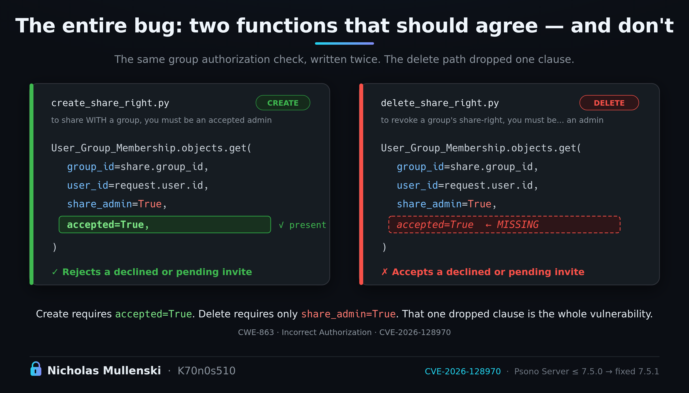
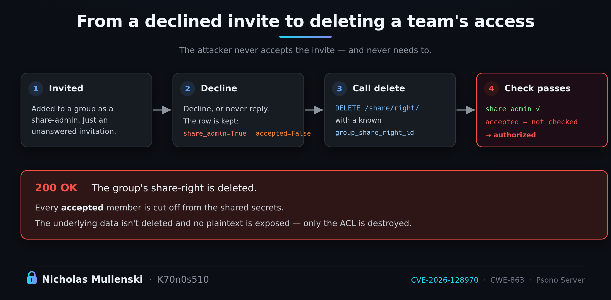
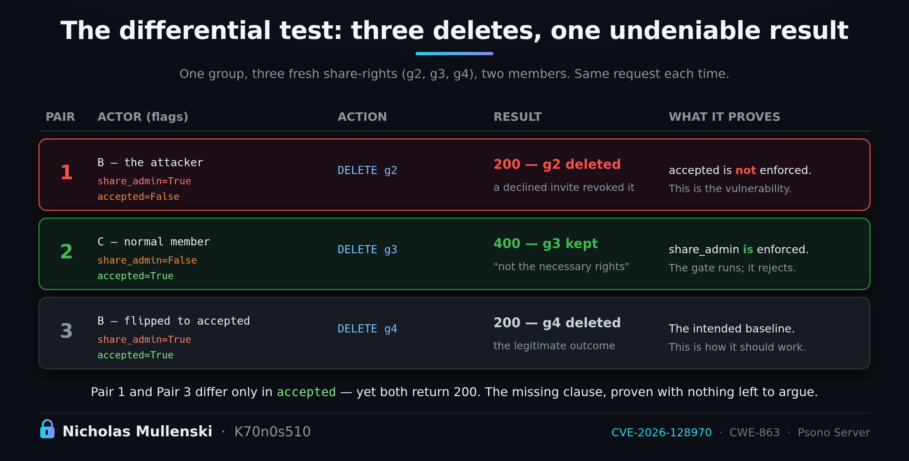

# How a one-line missing check let a declined invite delete a team's passwords (CVE-2026-128970, Psono)

I found a broken access control bug in Psono, the open-source password manager, by doing the least glamorous thing in security research: reading the code and comparing two functions that should agree with each other and don't.

No fuzzer. No AI. Just the source, a local instance, and one habit that finds this class of bug over and over.

Here is the whole process, start to finish.

## Why Psono

I wanted an open-source, self-hostable target where authorization actually matters. A password manager fits. If you can read, change, or revoke someone else's secrets without the right to, that is a real bug, and the server is end-to-end encrypted so the interesting attacks are about access control, not crypto.

Psono is a Django REST backend (gitlab.com/esaqa/psono). The whole server is right there to read, and it runs in Docker in a couple of minutes. That means I can read a handler, form a theory, and test it against the real endpoint the same afternoon.

## Setting up a real target

First thing I do with any target is get it running locally so I am testing the shipped code path, not a diagram in my head.

I pulled psono-server v7.5.0 and brought it up in Docker (Community edition). I created a couple of users, made a group, shared a secret into it, and clicked through the normal sharing flow in the UI while watching the requests. The point was not to find anything yet. It was to learn the object model: users, groups, shares, and the rows that tie them together.

The one that matters here is the group membership. When you invite someone to a group, Psono creates a User_Group_Membership row. That row has two flags I care about: share_admin, which decides whether the member can manage the group's shares, and accepted, which records whether the person has actually accepted the invite.

Hold onto those two flags. The bug lives in the gap between them.

## The habit that finds the bug: read the sibling

When I audit access control, I do not read handlers in isolation. I read them in pairs. Create and delete. Grant and revoke. Read and write. The authors almost always encode their intent correctly in one direction and get lazy in the other. If create requires X and delete does not, that difference is usually a bug, because the two operations are supposed to need the same right.

So I went to the sharing code and lined up the two operations on a group's share-rights.

Here is the create path, in restapi/serializers/create_share_right.py. To share with a group you must be a share_admin and you must have accepted:

```python
# check Permissions on group
User_Group_Membership.objects.get(
    group_id=attrs["group_id"],
    user_id=self.context["request"].user.id,
    share_admin=True,
    accepted=True,
)
```

Here is the delete path, in restapi/serializers/delete_share_right.py, which revokes a group's share-right:

```python
# check Permissions on group
User_Group_Membership.objects.get(
    group_id=share_right.group_id,
    user_id=self.context["request"].user.id,
    share_admin=True,
)
```

Read those two blocks again. Create requires share_admin=True and accepted=True. Delete requires share_admin=True only. The accepted=True clause is just gone.

That is the entire bug. The authors themselves wrote, in the same codebase, that managing a group's shares needs an accepted admin. The delete path forgot the "accepted" half. In CWE terms it is CWE-863, incorrect authorization: the check runs, but it authorizes a state it should have excluded.


*Create requires an accepted admin; delete requires only an admin. The one missing accepted=True clause is the entire vulnerability (CWE-863).*

## Turning an inconsistency into an attack

A missing clause is only interesting if a real user can be in the state it fails to exclude. So the question became: is there a normal way to have a membership row where accepted is False but the row still exists and still says share_admin=True?

Two obvious candidates: a pending invite you have not answered, and an invite you declined.

I checked what "decline" actually does, in restapi/views/membership_decline.py:

```python
membership_obj = serializer.validated_data.get("membership_obj")
membership_obj.accepted = False
membership_obj.save()
```

Declining does not delete the membership row. It sets accepted to False and saves it. So after you decline a share_admin invite, you are left holding exactly the row the delete check fails to reject: share_admin=True, accepted=False. A pending invite you never answered is the same story, except there accepted is still None.

Now I had a concrete attacker. Invite someone to a group as a share admin. They decline, or just never accept. They have no real access to anything. But their leftover membership row sails straight through the delete check, and they can revoke the group's share-rights, which cuts off every accepted member from the shared secrets.

For a password manager, "a person you removed from the team can still delete the team's access to its passwords" is a problem.


*The full chain: the attacker never accepts the invite — the leftover share-admin row sails straight through the delete check and returns 200.*

## Proving it against the real endpoint

A source read is a theory. I don't report theories. I report the shipped endpoint returning the wrong answer.

There was one real hurdle that made this hands-on. Psono does not take plain JSON on these endpoints. The request body is NaCl-encrypted: you send an envelope of a ciphertext and a nonce, and the server decrypts it with your session token's secret key before the handler ever sees it. You cannot just curl it.

So I seeded per-user session tokens into the database and wrote a small client that does what the real client does: encrypts the JSON body with NaCl and sends the envelope. Nothing about the parser or crypto was changed. The only thing under test was the authorization outcome.

Then I set up a clean three-way test so the result could not be hand-waved away. One group, three fresh share-right rows (call them g2, g3, g4), and two members. B is the attacker: share_admin true, accepted false, the declined or unaccepted invite. C is a control: a normal accepted member with share_admin false and accepted true.

Each test was the same request inside the encrypted envelope:

```
DELETE /share/right/
{ "group_share_right_id": "<g2 | g3 | g4>" }
```

Pair 1, the bug. Attacker B (not accepted, is admin) deletes g2. Result: HTTP 200, row g2 deleted. The unaccepted invite revoked the group's share-right.

Pair 2, the control. Member C (accepted, not admin) deletes g3. Result: HTTP 400, "You don't have the necessary rights to share with this group." Row g3 still there. This matters: it proves the delete endpoint really does check share_admin. The gate is not absent. It runs and it rejects. It is just missing the one accepted clause.

Pair 3, the baseline. B flipped to accepted true, admin, deletes g4. Result: HTTP 200, row g4 deleted. The legitimate outcome.


*Pair 1 vs Pair 3 differ only in the accepted flag, yet both return 200 — proof the clause isn't enforced. Pair 2 proves share_admin is.*

Line up Pair 1 and Pair 3. They are identical in every way except the accepted flag, and both delete the row and return 200. That is the proof that accepted is not enforced. Pair 2 proves share_admin is enforced. Combined with the create path having accepted=True right there in the source, the defect is pinned to exactly one missing clause, with nothing left to argue about.

## Impact, honestly

Psono is end-to-end encrypted, so I want to be precise and not oversell it. The attacker does not read any secret plaintext. This is not a disclosure bug. The confidentiality impact is none.

What the attacker gets is integrity and availability of the sharing ACLs. Someone who should hold no power over a group can delete that group's share-rights and cut every accepted member off from the shared secrets. The underlying shares and secrets are not deleted and their contents are never exposed; what is destroyed is the group's access to them.

I scored it conservatively as Medium, CVSS 5.4, vector CVSS:3.1/AV:N/AC:L/PR:L/UI:N/S:U/C:N/I:L/A:L. That is the rating assigned to CVE-2026-128970. I had floated a higher number for the case where the revoked share is business-critical, but the conservative 5.4 was the right one and it is the one that stuck. CISA's own enrichment lands in the same place: technical impact partial, not automatable, no known exploitation.

## The fix is the clause that was missing

The fix is the one line the create path already had:

```diff
  User_Group_Membership.objects.get(
      group_id=share_right.group_id,
      user_id=self.context["request"].user.id,
      share_admin=True,
+     accepted=True,
  )
```

After that, a declined or unaccepted invite's row no longer matches, the lookup raises DoesNotExist, and the endpoint returns the same 400 it already gives any other user without the right. esaqa shipped exactly this in commit 86e7ce7fdbb04fc4ae3430cc434179630948d48d, in version 7.5.1 of both the Community and Enterprise editions. I also suggested they audit the other membership checks for the same missing predicate, since one create/delete pair being out of sync is a good reason to check the rest.

## Disclosure

I reported it to esaqa by email on 2026-10-12. They acknowledged it the next day and confirmed it in both the Community and Enterprise editions. The affected range is Community Edition 1.12.6 through 7.5.0 and Enterprise Edition before 7.5.1; the fix shipped in v7.5.1 on 2026-10-13, about a day after the report. They assigned CVE-2026-128970 and credited the report. The whole thing was handled well and quickly, which is worth saying out loud, because it is not always the case.

## The takeaway for other researchers

The technique here is the whole point, and it is boring on purpose: in access-control code, read operations in pairs and compare their authorization checks. Create against delete. Grant against revoke. Add against remove. The developers write the correct rule once and then re-implement the mirror image by hand, and the mirror image is where the clause goes missing.

You do not need a fuzzer or a clever chain for this. You need the source, a running instance so you are testing reality, a clean differential so the result is undeniable, and the discipline to go read the sibling function every single time. That one habit has found more real authorization bugs for me than anything fancy.

---

CVE-2026-128970. Reported to esaqa GmbH by Nicholas Mullenski (K70n0s510); fixed in psono-server v7.5.1. Thanks to the esaqa team for a fast, professional response.
